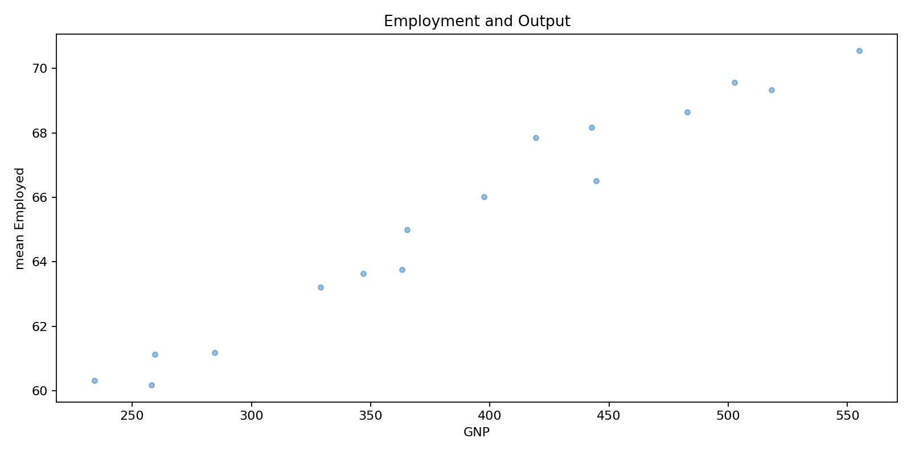

# Employment and Output — executed results

## Decision question
How are recorded economic output and employment associated?

## Evidence
Among 16 complete observations, Pearson r = 0.984 and Spearman rho = 0.985.

Raw rows: 16. Rows used: 16. Excluded for missing/nonfinite required values or invalid denominator: 0.

## Method
Complete-pair scatter plot of GNP and Employed, with Pearson and Spearman correlations. No regression adjustment or causal claim.

## Interpretation and limitations
Only 16 annual observations; common trends and collinearity can create misleading correlations. No causal inference, significance claim or production deployment is implied. Missing values are not imputed; identical rows are retained. Small or repeated samples limit uncertainty interpretation.

## Recommended next decision
Difference the series and inspect time dependence before modelling.

## Reproducibility
Source and exact downloaded-byte SHA256 are recorded in run_manifest.json. SQL results are in answer.csv and analysis.sqlite. Review quality_audit.csv before interpretation.
